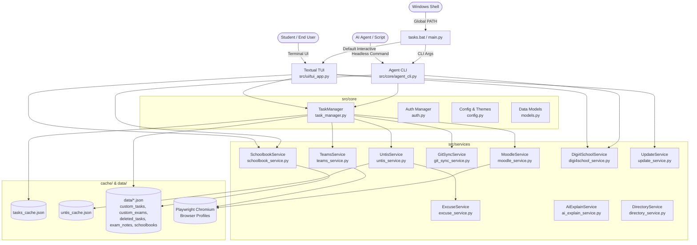
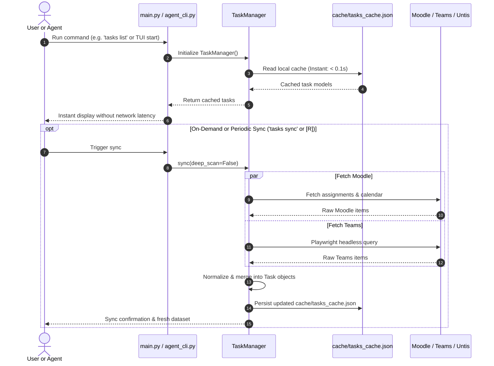
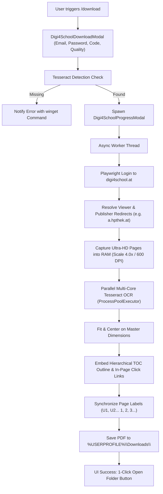

# Architecture & System Design — Tasks

## 1. High-Level Architecture

The system is structured as a layered, local-first Python application featuring a dual presentation layer (Interactive Textual TUI and Headless Agent CLI), an orchestrating Core layer, and specialized Service adapters communicating with external educational platforms.



---

## 2. Directory Structure & Key Modules

```text
Tasks/
├── assets/                     # Fonts (GentiumPlus) and app icons (app_icon.ico/png, icons/*.svg)
├── cache/                      # Persistent runtime caches & browser profiles
│   ├── tasks_cache.json        # Merged Moodle & Teams tasks snapshot
│   ├── untis_cache.json        # Timetable, absence & exam records
│   ├── moodle_courses_cache.json # Catalog of courses for fuzzy jump
│   └── teams_browser_profile/  # Persistent Playwright storage state
├── data/                       # User-generated state files
│   ├── custom_tasks.json       # User-created manual assignments
│   ├── custom_exams.json       # Manually declared exams
│   ├── deleted_tasks.json      # Soft-deleted / hidden assignments
│   ├── exam_notes.json         # Exam revision notes & syllabus points
│   └── schoolbooks.json        # Local PDF & web textbook bookmarks (unsynced)
├── docs/                       # Modular documentation & persistent memory
│   ├── project-overview.md
│   ├── architecture.md
│   ├── conventions.md
│   ├── current-state.md
│   └── decisions.md
├── installer/                  # Packaging & licensing system
│   ├── tasks.iss               # Inno Setup 6 compilation script
│   ├── build_installer.py      # Automated installer builder
│   └── generate_license.py     # HMAC-SHA256 license generator
├── scripts/                    # Windows environment helper scripts
│   ├── setup_command.bat       # Registers 'tasks' in user PATH
│   ├── remove_command.bat      # Unregisters 'tasks' from user PATH
│   ├── setup_terminal_profile.bat      # Autarkes Batch/PowerShell-Skript zur Registrierung des Windows-Terminal-Profils
│   └── remove_terminal_profile.bat     # Autarkes Batch/PowerShell-Skript zur Entfernung des Windows-Terminal-Profils
├── src/
│   ├── core/                   # System core & data management
│   │   ├── agent_cli.py        # Token-efficient headless CLI engine
│   │   ├── auth.py             # HTTP direct & interactive authentication (Moodle HTTP, Teams browser)
│   │   ├── config.py           # Paths, color palettes, favorite themes & normalization
│   │   ├── dependency_checker.py # Pre-flight module checker & warning banner
│   │   ├── license.py          # Legacy hardware fingerprinting / compatibility
│   │   ├── models.py           # Dataclass definitions
│   │   ├── task_manager.py     # Central aggregation & caching coordinator
│   │   └── win_dialogs.py      # Per-Monitor DPI-Awareness v2 & native Windows COM IFileOpenDialog
│   ├── services/               # External portal integration adapters
│   │   ├── ai_explain_service.py # AI prompt generation, clipboard copy & browser / app launcher
│   │   ├── ai_chat_service.py    # In-app AI chat: attachment extraction, Gemini/OpenAI dispatch, chat cache
│   │   ├── directory_service.py # Directory linking, listing, course auto-matching & Explorer launcher
│   │   ├── excuse_service.py   # PDF absence excuse generator
│   │   ├── git_sync_service.py # Multi-device repository sync (including favorites)
│   │   ├── moodle_service.py   # Moodle scraping & REST API
│   │   ├── schoolbook_service.py # Schoolbook indexing, opening & file picker
│   │   ├── digi4school_service.py # Digi4School book downloader, OCR & TOC generator
│   │   ├── teams_service.py    # Playwright MS Teams scraper
│   │   ├── untis_service.py    # WebUntis JSON-RPC client, schoolquery2 resolver & timetable/absence matcher
│   │   └── update_service.py   # GitHub release update checker, in-app downloader & runner
│   └── ui/                     # Presentation implementations
│       ├── tui_app.py          # Interactive Textual TUI
│       └── ui.py               # Rich terminal rendering utilities
├── tests/                      # Automated test suite (pytest / unittest)
│   ├── test_agent_cli.py       # Unit tests for CLI agent & skill commands
│   ├── test_ai_chat_service.py # Unit tests for AI Chat attachment extraction, dispatch & explain state
│   ├── test_ai_chat_ui.py      # Unit tests for AI Assistant TUI screen, tabs & deduplication
│   ├── test_ai_explain.py      # Unit tests for AI Explain prompt generation & desktop app launcher
│   ├── test_auth_logins.py     # Unit tests for Moodle HTTP & Untis login & server resolution
│   ├── test_schoolbooks.py     # Unit tests for schoolbooks & git isolation
│   ├── test_digi4school.py     # Unit tests for Digi4School downloader & CLI
│   ├── test_dependency_checker.py # Unit tests for pre-flight dependency checker
│   └── test_update_service.py  # Unit tests for update checker & modals
├── AGENTS.md                   # Tier 1 master documentation index (< 3 KB)
├── config.json                 # User configuration file
├── config.example.json         # Reference configuration template
├── main.py                     # Root entry point wrapper
├── requirements.txt            # Dependency specifications
├── run.bat                     # Desktop launch batch file
└── tasks.bat                   # Global PATH command runner
```

---

## 3. Data Flow & Synchronization Strategy

The application enforces a **Local-First, Offline-Read** architectural pattern:



### Two-Tier Startup Lifecycle
1. **Tier 1 (Instant Cache Hit & Lazy Heavy Subsystems)**:
   - On execution, `TaskManager` loads `cache/tasks_cache.json` and `data/` immediately.
   - Heavy submodules (`fpdf2`, `PyMuPDF`/`fitz`, `PIL`, `pytesseract`, `playwright`, `requests`) are imported on-demand (lazy loading), keeping the initial import footprint lightweight.
   - Synchronous disk scanning (`clean_browser_profile_caches`) is deferred to a background daemon thread, allowing the TUI or CLI to output data and render within **100–1100 milliseconds** (down from ~1.9s).
2. **Tier 2 (Background Prefetch & Live Sync)**:
   - In interactive TUI mode, an optional background worker can prefetch task details or thumbnails.
   - Live synchronization is triggered explicitly via `[R]` in TUI or `tasks sync` in CLI to prevent unprompted network stalls.

---

## 4. Key Interfaces & Contracts

### Core Data Models (`src/core/models.py`)

- **`Task`**:
  ```python
  @dataclass
  class Task:
      id: str                 # Unique ID, e.g. "moodle_10421" or "teams_19_xxx"
      platform: str           # "moodle" | "teams" | "manual"
      course: str             # Normalized subject acronym (e.g., "SWP", "SESD")
      course_full: str        # Original portal course name
      title: str              # Assignment title
      due_date_str: str       # Localized date string ("Freitag, 16.10. 23:59")
      due_timestamp: float    # Unix epoch timestamp for chronological sorting
      status: str             # "offen" | "erledigt"
      status_display: str     # "Open" | "Done" | "Overdue"
      url: str                # Official deep-link to submission portal
      description: str        # HTML-cleaned markdown assignment description
      teacher: str            # Assigned teacher acronym or name
      attachments: List[Attachment] # Associated assignment files
      details_loaded: bool    # Lazy-loading status indicator
  ```

- **`UntisExam`**:
  ```python
  @dataclass
  class UntisExam:
      id: str                 # Unique exam ID from Untis
      date_str: str           # ISO date string (YYYY-MM-DD)
      start_time: str         # "08:00"
      end_time: str           # "09:40"
      subject: str            # Subject code (e.g., "M", "E", "SWP")
      teacher: str            # Teacher code
      exam_type: str          # "Schularbeit", "Kurztest", "Mündlich"
      notes: str              # Teacher instructions or syllabus notes
  ```

---

## 5. Security & Isolation Architecture

1. **Zero-Knowledge Principle**:
   - Web credentials (usernames, passwords, MFA tokens) never leave the user's local machine.
   - Authentication against Teams and Moodle relies on Chromium user profiles stored in `cache/*_browser_profile/`.
   - The CLI and TUI output only public assignment texts; no private auth headers or session tokens are printed or logged.

2. **Open-Source Distribution & Packaging Pipeline (`installer/`)**:
   - Universal Windows installers (`Tasks_Setup.exe`) are generated using Inno Setup 6 without machine-specific locks or hardware restrictions.
   - The build script (`installer/build_installer.py`) downloads the official offline Python 3.12 installer on demand, keeping the Git repository lightweight.
   - Dual-icon packaging guarantees that both `assets/app_icon.ico` (Desktop/Start Menu) and `assets/app_icon.png` (Windows Terminal custom profile) are validated, restored on demand via vector fallbacks or PIL (`ensure_app_icons()`), and enforced at compile-time under `tasks.iss` `[Files]`.
   - Windows Terminal profiles are registered idempotently with schema-hardening (`profiles.list` vs. legacy array) via `scripts/setup_terminal_profile.bat`.
   - An automated GitHub Actions workflow (`.github/workflows/release.yml`) builds and publishes installers directly to GitHub Releases upon tag creation.

3. **Git Cloud-Sync Security & Concurrency (`src/services/git_sync_service.py`)**:
   - Personal Access Tokens (PAT) are stripped and masked via `mask_git_url()` before any logging or UI presentation.
   - Non-interactive subprocess execution is strictly enforced via `-c credential.helper=`, `-c core.askPass=`, `SSH_ASKPASS=""`, and `GIT_TERMINAL_PROMPT=0` to prevent background UI/credential stalls.
   - Thread synchronization utilizes reentrant locking (`threading.RLock`) to safely coordinate `setup_repository`, `pull_and_sync`, and `push_changes` without deadlock risks.

4. **Local-Only Schoolbook Isolation (`src/services/schoolbook_service.py`)**:
   - Schoolbook bookmarks and local PDF filesystem paths are persisted in `data/schoolbooks.json` (and user cache fallback).
   - Absolute filesystem paths are machine-specific and strictly excluded from Git synchronization (`.gitignore`, `data/.gitignore`, and excluded from `GitSyncService.push_changes()`) to avoid broken links across multi-device sync.

5. **Digi4School In-Memory Credentials & Session Defense (`src/services/digi4school_service.py`)**:
   - Digi4School credentials (email & password) are prompted interactively in memory on each run and immediately cleared after login, never written to disk or configuration files.
   - External browser session conflicts (Fehler 911) and Info-Tour modals are intercepted automatically by DOM cleanup and auto-recovery.

---

## 6. Digi4School Book Grabber Architecture

The Digi4School subsystem (`src/services/digi4school_service.py`) enables automated, headless extraction of digital textbooks into high-fidelity searchable OCR-PDFs:



- **Ultra-HD Resolution & Adaptive DPI Coupling**: Renders pages by default with Playwright's `device_scale_factor = 4.0` and dynamically couples OCR DPI via `effective_dpi = int(150 * scale)` (600 DPI standard), keeping standard A4/B5 physical geometry while quadrupling zoom sharpness. Supports quick presets (`ultra`, `high`, `standard`) and pure image archives (`--no-ocr`).
- **Live ETA & Progress Calculation**: Real-time progress updates are reported via thread-safe callbacks to the TUI and CLI. The remaining time (ETA) estimates both active page rendering and multi-core OCR throughput based on dynamic elapsed-time rates.

