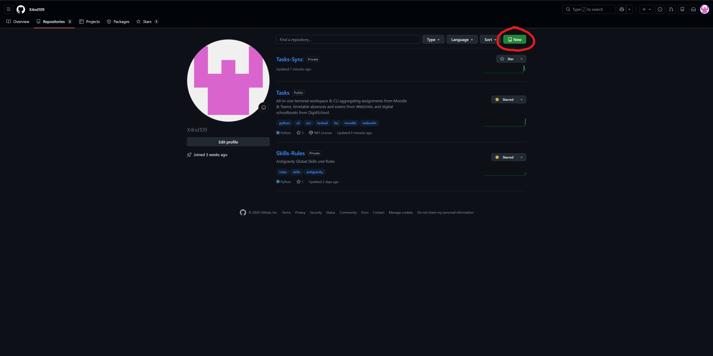
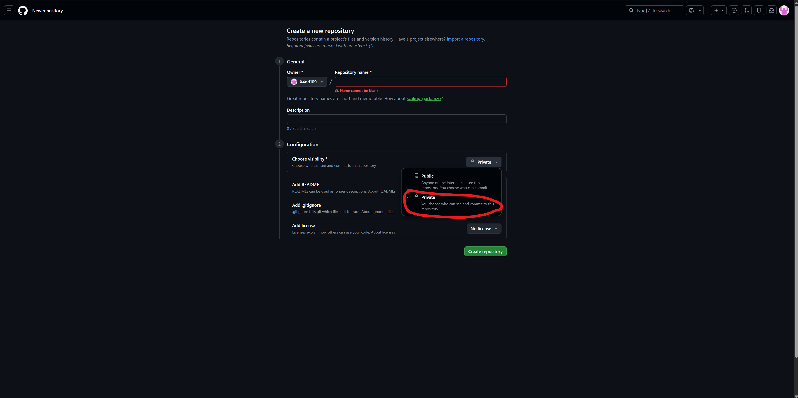
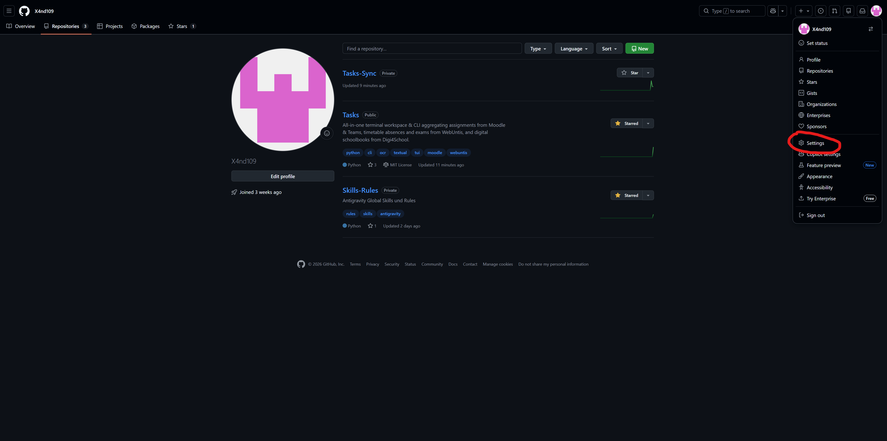
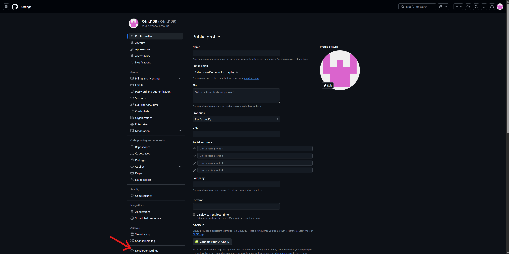
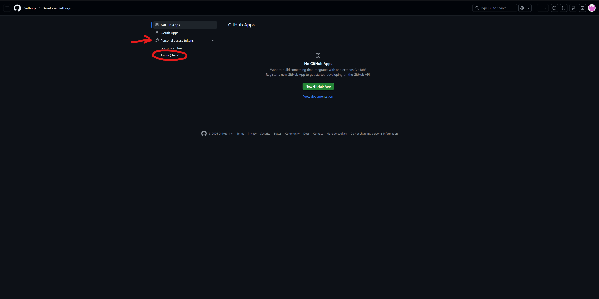
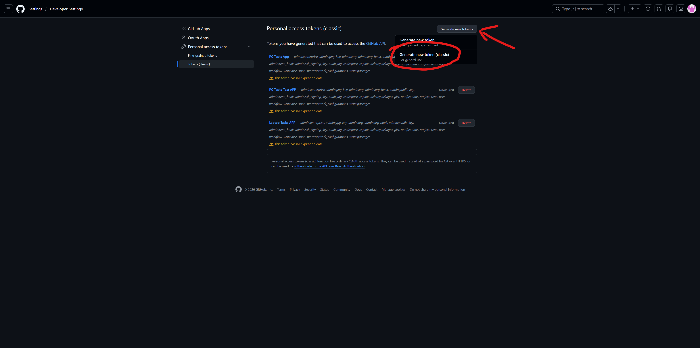
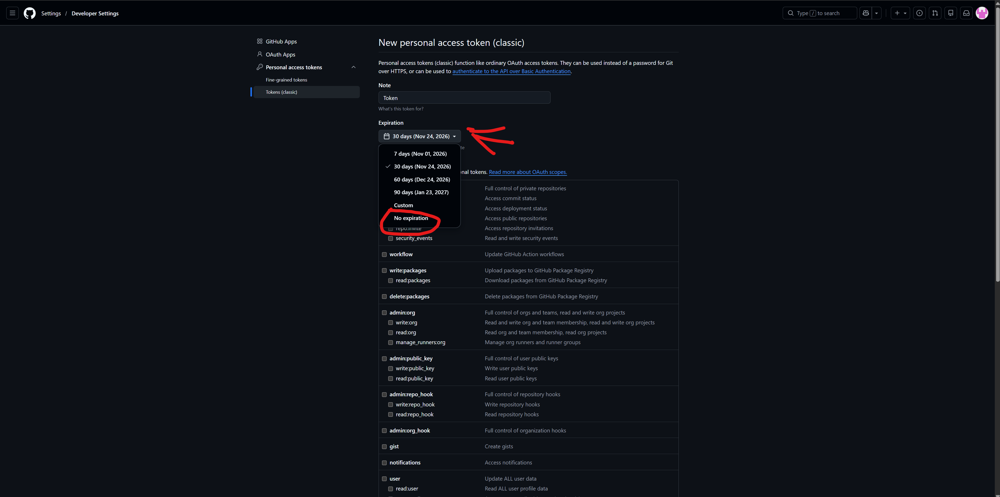
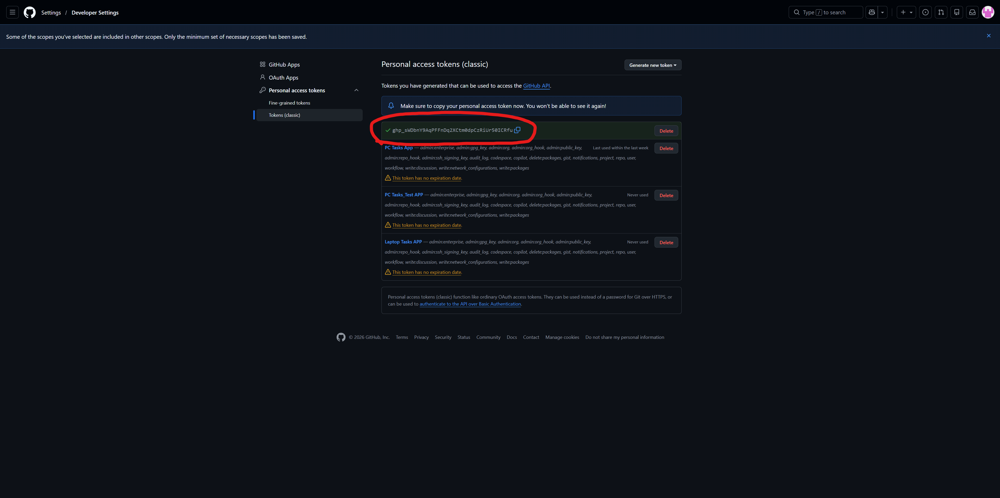

# Git Cloud-Sync Setup Guide

This guide walks you through setting up **Git Cloud-Sync** in the Tasks app. Git Cloud-Sync lets you automatically synchronize your school assignments, exams, homework status, and custom notes between your PC, Laptop, and any other workstation without relying on third-party cloud subscriptions.

---

## Prerequisites & Requirements

- A [GitHub](https://github.com) account.
- The Tasks app installed on your device.

> [!IMPORTANT]
> **Data Privacy Notice**: Your tasks may contain personal school notes, homework details, and teacher comments. **Always create a Private repository** so your school data is never publicly exposed on GitHub.

---

## Step 1: Create a Private GitHub Repository

1. Log in to [GitHub](https://github.com).
2. Click the **`+`** icon in the top right corner of the navigation bar and select **New repository** (or navigate directly to [github.com/new](https://github.com/new)).



3. Configure your repository:
   - **Repository name**: Choose a descriptive name, e.g. `school-tasks-sync` or `tasks-backup`.
   - **Visibility**: Select **Private**.

> [!CAUTION]
> Ensure **Private** is selected! A public repository will expose your assignments and personal notes to the entire internet.



4. *(Optional)* You do not need to initialize the repository with a README or `.gitignore` (the Tasks app will initialize the sync branch automatically).
5. Click **Create repository**.
6. Note down your repository's HTTPS clone URL (e.g., `https://github.com/<your-username>/school-tasks-sync.git`).

---

## Step 2: Open GitHub Settings

To allow the Tasks app to securely authenticate with your GitHub repository without storing your account password, you need to create a **Personal Access Token (PAT)**.

1. Click on your **profile picture** in the upper right corner of GitHub.
2. Select **Settings** from the dropdown menu.



---

## Step 3: Navigate to Developer Settings

1. In the left sidebar of your Settings page, scroll down to the very bottom.
2. Click on **Developer settings**.



---

## Step 4: Open Personal Access Tokens (Classic)

1. In the Developer Settings sidebar, expand **Personal access tokens**.
2. Click on **Tokens (classic)**.



3. Click on the **Generate new token** dropdown button in the top right, and choose **Generate new token (classic)**.



---

## Step 5: Configure Token (No Expiration & Scopes)

1. **Note**: Enter a descriptive name so you remember what this token is used for (e.g., `Tasks App Cloud Sync`).
2. **Expiration**: In the dropdown menu, select **No expiration**.
   > [!NOTE]
   > Setting "No expiration" ensures that your background and on-demand synchronization will never fail unexpectedly due to an expired token.
3. **Select scopes**: Check **all scopes** (select all check boxes) to grant the token all necessary repository management permissions.



4. Scroll to the bottom of the page and click the green **Generate token** button.

---

## Step 6: Copy Your Token

GitHub will generate and display your personal access token starting with `ghp_...`.

> [!WARNING]
> **Copy the token immediately!** GitHub will never display this token again once you navigate away from or refresh this page. If you lose it, you will need to generate a new one.

1. Click the **Copy** icon next to the token string to copy it to your clipboard.



---

## Step 7: Configure Git Cloud-Sync in Tasks

1. Launch the Tasks application:
   ```powershell
   python main.py
   ```
2. Navigate to **⚙️ Settings** (`S`) $\rightarrow$ **🔑 Login** $\rightarrow$ **🐙 Git Cloud-Sync** (or press shortcut `4` / `G` in the login menu).
3. In the **🐙 Git Cloud-Sync Setup** modal:
   - **Repository HTTPS URL**: Paste your repository URL, e.g.:
     ```text
     https://github.com/<your-username>/school-tasks-sync.git
     ```
   - **Personal Access Token (PAT)**: Paste the token you copied in Step 6 (`ghp_...`).
   - **Branch**: Keep the default (`main`).
4. Click **🚀 Test & Connect**.

Once verified, the status indicator will turn green:
```text
Connected ✓ (Last Sync: Never / <timestamp>)
```

---

## Security & Storage Architecture

- **Local Encryption**: Your Personal Access Token is stored securely in your local user configuration. It is never transmitted to any third-party server besides GitHub's official API/Git endpoints.
- **Zero-Conflict Syncing**: Tasks uses automated push/pull reconciliation to sync assignments across multiple devices without overwriting local modifications.
- **Disconnecting**: You can disconnect Cloud-Sync at any time by opening the Git Setup dialog and clicking **🗑️ Disconnect**.
